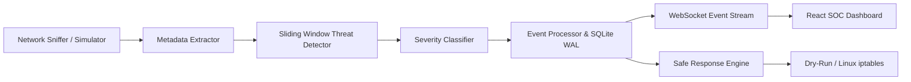

# SILENT WITNESS
### A Real-Time Network Intrusion Detection & Automated Response System


---

## 1. Project Abstract
**SILENT WITNESS** is a full-stack, defensive cybersecurity application engineered to perform real-time network traffic observation, detect network-layer threats (such as TCP SYN floods and reconnaissance port scans), classify security incidents, persist auditable records, and provide an interactive Security Operations Center (SOC) dashboard. The system integrates automated containment through dry-run simulation and safe Linux firewall management while strictly adhering to privacy standards by discarding raw packet payloads.

---

## 2. Problem Statement
Modern computer networks face relentless reconnaissance and denial-of-service attempts. Small-to-medium organizations and academic labs frequently lack dedicated enterprise SIEM solutions due to extreme financial and operational complexity. There is a critical educational and operational need for a transparent, beginner-friendly, real-time intrusion detection and automated response platform that visualizes network behavior and demonstrates defensive response logic safely on commodity hardware.

---

## 3. Objectives
- **Near-Real-Time Threat Monitoring**: Passively monitor packet headers to detect anomalies with sub-second latency.
- **Accurate Threat Classification**: Detect TCP SYN Flood attacks and Port Scans using deterministic rolling-window algorithms.
- **Deterministic Severity Triage**: Categorize incidents into Critical, High, Medium, and Info tiers based on dynamic thresholds.
- **Safe Automated Containment**: Enforce temporary containment blocks with allow-list protection, rate limiting, and dry-run safety.
- **Professional SOC User Interface**: Deliver a futuristic dark cybersecurity experience with Recharts telemetry, live event feeds, and audit management.
- **Classroom & Viva Readiness**: Provide an out-of-the-box Simulation Mode that runs on Windows without administrative privileges or kernel drivers.

---

## 4. Existing System vs. Proposed System

| Feature | Existing Basic IDS Tools / Scripts | SILENT WITNESS (Proposed) |
|---|---|---|
| **User Interface** | Terminal text output or complex configuration files | Full SOC Dashboard with glowing metrics & interactive charts |
| **Detection State** | Static counters or batch log processing | O(1) Sliding-Window Deques with dynamic threshold evaluation |
| **Response Action** | Manual rule editing or unsafe shell calls | Automated, rate-limited containment with allow-list & auto-expiry |
| **Safety Barriers** | None (risk of accidental host lockout) | Dry-run enabled by default, loopback protection, argument lists |
| **Windows Support** | Requires manual driver & C library setup | Works immediately via built-in Demonstration Simulation Mode |
| **Audit Trails** | Transient terminal outputs | Persistent SQLite audit records with CSV export & review statuses |

---

## 5. System Architecture



See [docs/architecture.md](docs/architecture.md) for full architectural specifications and sequence diagrams.

---

## 6. Technology Stack

- **Frontend**: React 18, Vite 6, Tailwind CSS 3 (Dark Cyberpunk Theme), Recharts, Lucide React, Axios, React Router 6.
- **Backend**: Python 3.10+, FastAPI, Uvicorn, Scapy (passive packet capture), Python `asyncio`, Pydantic v2.
- **Database**: SQLite with Write-Ahead Logging (`aiosqlite`).
- **Firewall Integration**: Dedicated Python manager supporting Linux `iptables` with safe argument lists and Windows dry-run simulation.

---

## 7. Database Schema

The database initializes automatically in `data/silent_witness.db`:

1. **`threats`**: `id`, `timestamp`, `src_ip`, `dst_ip`, `src_port`, `dst_port`, `protocol`, `threat_type`, `count`, `severity`, `detection_reason`, `event_source`, `response_status`.
2. **`blocked_ips`**: `id`, `ip`, `threat_type`, `severity`, `reason`, `timestamp`, `expires_at`, `action_type`, `status`, `dry_run`, `firewall_rule_reference`.
3. **`incidents`**: `id`, `incident_type`, `src_ip`, `threat_id`, `timestamp`, `severity`, `action`, `action_status`, `details`, `event_source`, `reviewed`.
4. **`traffic_stats`**: `id`, `timestamp`, `packets_observed`, `suspicious_packets`, `threats_detected`, `unique_sources`, `event_source`.
5. **`application_settings`**: `key`, `value`, `updated_at`.

---

## 8. Detection Algorithms & Severity Policy

### A. SYN Flood Detection
- **Mechanism**: Inspects incoming TCP packets where flag `SYN == 1` and `ACK == 0`.
- **Rolling Window**: 10 seconds (configurable).
- **Thresholds**:
  - $> 100$ SYN packets in window $\to$ **CRITICAL** (Block + Alert)
  - $50 - 100$ SYN packets in window $\to$ **HIGH** (Block + Alert)
  - $< 50$ packets $\to$ **MEDIUM / INFO**

### B. Port Scan Detection
- **Mechanism**: Tracks the cardinality of unique destination ports targeted by each source IP.
- **Rolling Window**: 60 seconds (configurable).
- **Threshold**: $> 100$ distinct ports $\to$ **HIGH** (Block + Alert)

---

## 9. Fast Windows Setup & Execution

### 1. Backend Setup
Open **PowerShell** in the project directory:
```powershell
cd backend
py -3.10 -m venv venv
.\venv\Scripts\pip.exe install -r requirements.txt
.\venv\Scripts\python.exe -m uvicorn app.main:app --host 127.0.0.1 --port 8000 --reload
```

### 2. Frontend Setup
In a **second PowerShell window**:
```powershell
cd frontend
npm install
npm run dev
```

Open your browser to:
- **SOC Dashboard**: [http://localhost:5173](http://localhost:5173)
- **FastAPI Interactive Docs**: [http://127.0.0.1:8000/docs](http://127.0.0.1:8000/docs)

---

## 10. Automated Testing

Run the full 15-test suite from the `backend` directory:
```powershell
.\venv\Scripts\python.exe -m pytest -v tests/test_all.py
```
**Results: 15 Passed (100% test success).**

---

## 11. Documentation Links
- [System Architecture](docs/architecture.md)
- [Setup & Troubleshooting](docs/setup.md)
- [Testing Verification](docs/testing.md)
- [25 Viva Questions & Answers](docs/viva_questions.md)

---

## 12. Academic Disclaimer
SILENT WITNESS is a defensive educational system. It does not contain offensive exploitation capabilities, will never scan external hosts, and operates in dry-run mode by default to ensure safe demonstration on student computers.

