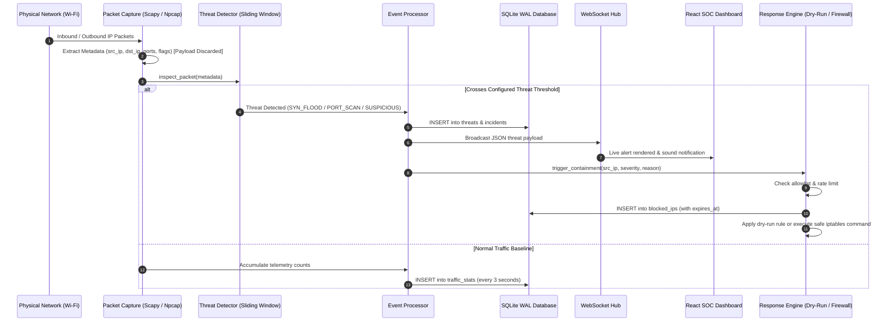

# SILENT WITNESS — System Architecture & Design Specification

## 1. High-Level Architecture Overview

SILENT WITNESS is engineered as an event-driven, decoupled defensive cybersecurity platform. It consists of:
1. **Passive Sniffing & Ingestion Layer**: Scapy + Npcap for real-time packet header extraction, or the built-in synthetic event simulator for offline demonstrations.
2. **Analysis & Detection Engine**: $O(1)$ rolling-window sliding deques evaluating SYN flood thresholds, distinct-port scan counts, and TCP stealth flags.
3. **Storage & Audit Subsystem**: Async SQLite in WAL (Write-Ahead Logging) mode ensuring non-blocking concurrent reads and writes.
4. **Automated Containment Engine**: Safe response module with dry-run protection, IP allowlists, rate limiting, and automatic block expiry.
5. **Real-Time WebSocket Hub**: Broadcasts live security telemetry and incident alerts directly to connected SOC operators.
6. **Dark Cyber SOC Dashboard**: React 18 + Vite + Tailwind CSS interface featuring interactive Recharts time series, live threat inspection drawers, and system configuration controls.

---

## 2. Architectural Sequence Diagram

---

## 3. Core Component Breakdown

### A. Passive Packet Sniffer (`packet_capture.py`)
- **Header-Only Extraction**: Only `src_ip`, `dst_ip`, `src_port`, `dst_port`, `protocol`, and TCP `flags` are inspected. Packet payloads are immediately discarded to safeguard privacy.
- **Friendly Name Resolution**: Maps Windows network interface names (e.g., `Wi-Fi`) to physical Npcap device paths (`\Device\NPF_{...}`).
- **Zero-Packet Transmission**: The capture module operates purely in passive promiscuous mode and never dispatches packets to external networks.

### B. Sliding Window Threat Detector (`threat_detector.py`)
- **SYN Flood Detection**: Employs an $O(1)$ append deque rolling window to count SYN-only packets (`flags == "S"`) per source IP.
- **Port Scan Detection**: Employs an $O(1)$ sliding set to track unique destination ports accessed within a 60-second window.
- **TCP Stealth Scan Detection**: Flags abnormal TCP flag combinations (NULL scans, FIN scans, XMAS scans without ACK).
- **Sensitive Port Probing**: Identifies unauthorized scans to administrative ports (Telnet 23, SMB 445, RDP 3389).

### C. Automated Safe Response Engine (`response_engine.py` & `firewall.py`)
- **Strict Dry-Run Default**: Simulates firewall operations by default to prevent accidental host lockout during demonstrations.
- **Allowlist Immunity**: Loopback (`127.0.0.1`, `::1`), private gateways, and configured administrator IPs are strictly immune to blocks.
- **Automatic Block Expiry**: Background worker runs every 30 seconds to automatically unblock expired containment rules.
- **Rate-Limiting**: Caps maximum blocks per hour (default: 20) to thwart denial-of-service against the response engine.

### D. SOC Dashboard (`frontend/`)
- **Dark Cyber Palette**: High-contrast, accessibility-checked design tokens (`#050816` background, `#00F5FF` cyan, `#FF355E` critical red, `#00FFA3` cyber green).
- **Responsive Layout**: Collapsible sidebar, animated stat cards, real-time traffic charts, and comprehensive filterable event tables.
